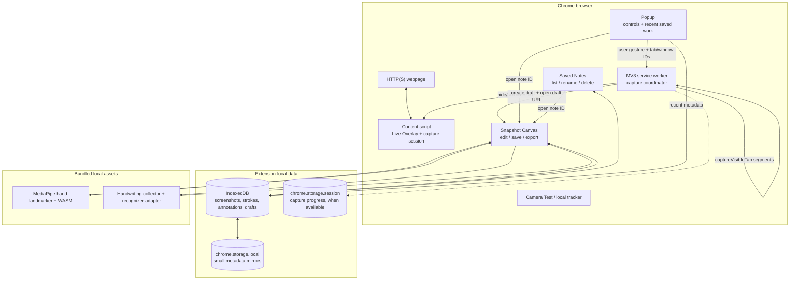
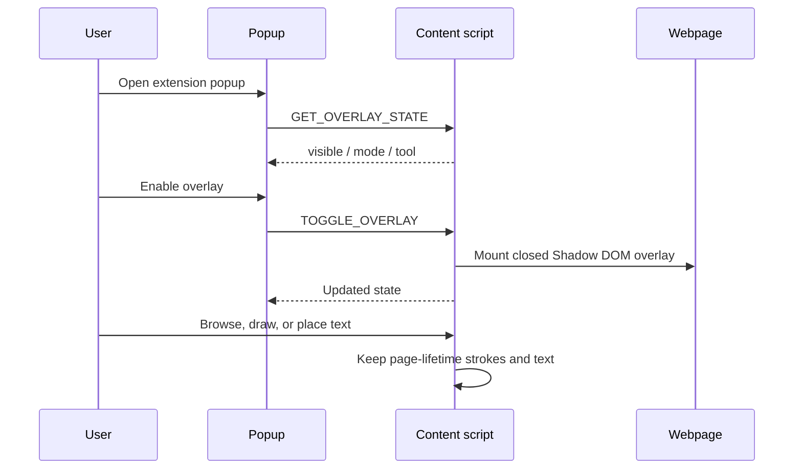
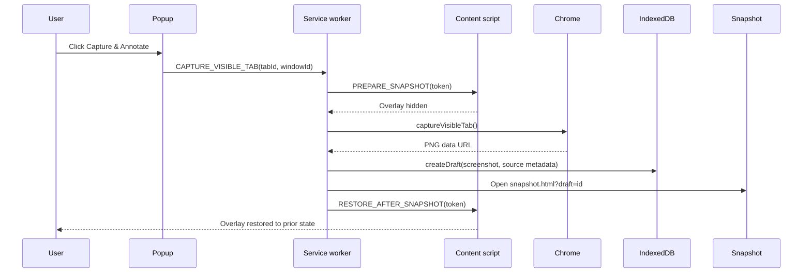
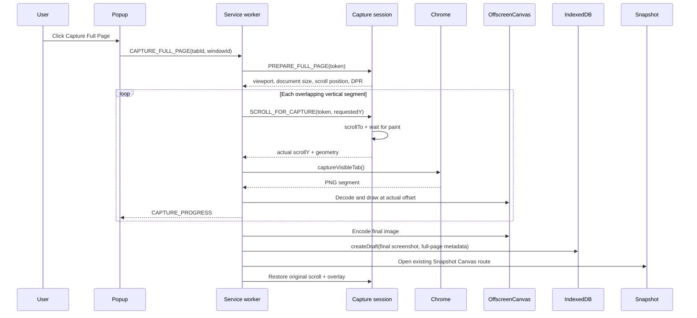
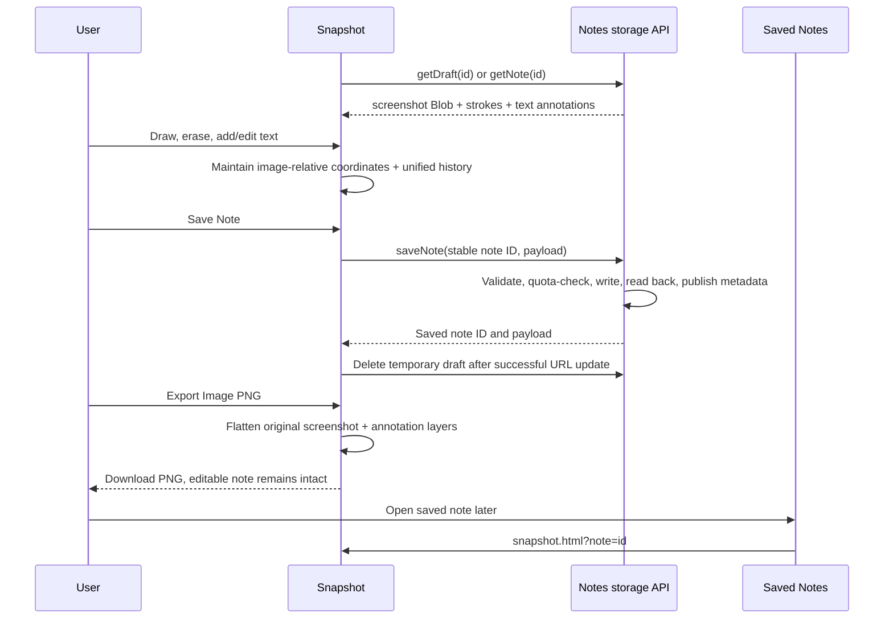
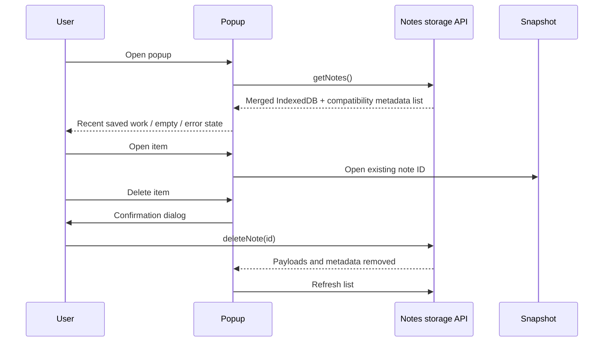
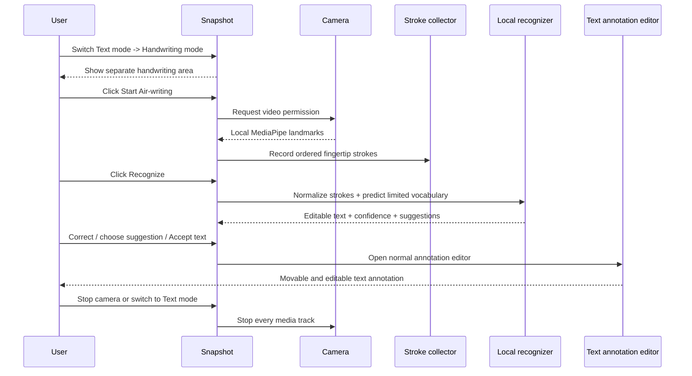
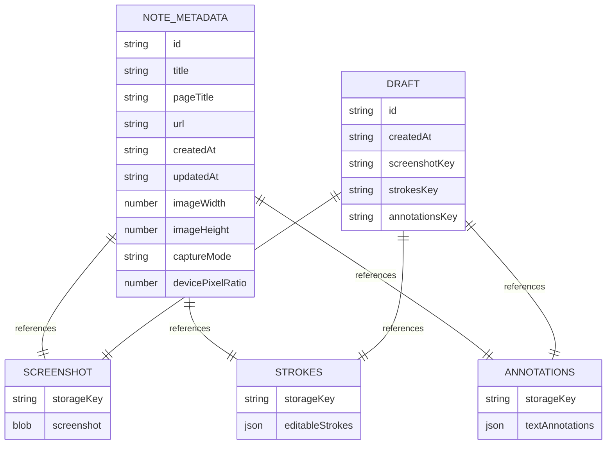

# Overlayed

> A local-first Chrome Manifest V3 extension for drawing, text annotation,
> full-page capture, saved snapshot workspaces, and opt-in handwriting input.

[](manifest.json)
[](.nvmrc)
[](tests/)
[](storage/README.md)

Overlayed lets you mark up a webpage without sending page content, screenshots,
camera frames, or notes to a server. Use the live overlay for quick, page-local
annotations, or capture a viewport/full page into the existing Snapshot Canvas
workspace for editable notes and flattened PNG export.

The project is intentionally dependency-light: plain JavaScript, HTML, CSS,
Canvas 2D, IndexedDB, Chrome extension APIs, and locally bundled MediaPipe
assets. There is no backend, account, cloud sync, runtime CDN, or runtime npm
dependency.

## Contents

- [What it does](#what-it-does)
- [Architecture](#architecture)
- [System workflows](#system-workflows)
- [Data and storage model](#data-and-storage-model)
- [Project structure](#project-structure)
- [Security and privacy](#security-and-privacy)
- [Setup](#setup)
- [How to use](#how-to-use)
- [Testing and verification](#testing-and-verification)
- [Known limitations](#known-limitations)
- [Roadmap](#roadmap)
- [Design decisions](#design-decisions)
- [License and third-party assets](#license-and-third-party-assets)

## What it does

### Live Overlay

- Fixed, transparent drawing surface over ordinary `http://` and `https://` pages.
- Browse mode passes links, scrolling, and text selection through to the page.
- Draw mode supports mouse, trackpad, pen, and touch pointer events.
- Pen, pixel eraser, three pen colours, width control, clear, undo, redo, hide,
  and collapse/expand controls.
- Text tool creates movable, editable, recolourable, resizable text annotations.
- Live overlay state is page-lifetime state; it is intentionally not autosaved.

### Snapshot Canvas

- **Capture & Annotate** captures the visible viewport.
- **Capture Full Page** scrolls and stitches stable vertical pages into the same
  Snapshot Canvas route: `snapshot/snapshot.html?draft=<draft-id>`.
- Full-page capture records actual scroll offsets, restores the source page's
  original position, throttles capture calls, and rejects unsupported or unsafe
  dimensions rather than opening a partial screenshot.
- Image-relative drawing and text coordinates remain aligned when the workspace
  is resized or displayed at a different scale.
- Save editable notes, reopen them by ID, rename/delete from Saved Notes, and
  export a flattened PNG without destroying the editable source.

### Saved work and handwriting

- Popup Recent saved work list with open/reopen and confirmed delete actions.
- One IndexedDB/Chrome-storage note repository shared by popup, notes page, and
  Snapshot Canvas; no second popup database.
- Text mode is the default and does not request camera permission.
- Optional Handwriting mode uses a separate stroke collector and local limited
  vocabulary adapter. Predictions are editable, suggestions are selectable, and
  keyboard correction is always available.
- Accepted handwriting enters the normal movable/editable text annotation flow.
- Existing air-writing gestures remain available in Snapshot Canvas for draw,
  hover, and erase actions.

## Architecture

Overlayed is organized around four extension contexts and one local persistence
layer. The background service worker coordinates privileged capture operations;
the content script owns the live page overlay; extension pages own their own UI
state; IndexedDB owns screenshot and annotation payloads.

For the context inventory, message contracts, storage authority, and packaging
decision, see [`docs/architecture.md`](docs/architecture.md). The persistence
contract is also maintained separately in [`docs/storage.md`](docs/storage.md).



### Context responsibilities

| Context | Responsibility | Does not own |
| --- | --- | --- |
| `content/content.js` | Live overlay lifecycle, tokenized page geometry, scroll and restore session | Screenshot blobs or saved notes |
| `background.js` | Validate the initiating tab, call `captureVisibleTab`, stitch segments, create drafts, open Snapshot | Long-lived editor state |
| `popup/` | Ephemeral controls, full-page/viewport capture actions, recent notes | A second note store or live annotation state |
| `snapshot/` | Editable screenshot workspace, drawing/text history, export, optional camera/handwriting | Page overlay state |
| `notes/` | Saved-note browsing, thumbnails, rename, confirmed delete | Screenshot editing |
| `storage/notes.js` | Validation, quota accounting, IndexedDB payloads, compatibility metadata | UI rendering |
| `camera/` | Local camera lifecycle and MediaPipe hand-tracking adapter | Persistent camera frames |

## System workflows

### 1. Enable and use the live overlay



### 2. Capture the visible viewport



### 3. Capture a full page by scroll-and-stitch



The MVP intentionally supports stable, vertically scrolling documents. It rejects
horizontal overflow, changing dimensions, skipped scroll positions, oversized
canvas output, and unsupported image encoding. Sticky/fixed page widgets can be
repeated between segments; this is documented and manually tested rather than
silently hidden or changed in the source page.

### 4. Edit, save, reopen, and export



### 5. Popup recent saved work



### 6. Optional handwriting mode



## Data and storage model

Overlayed stores large payloads in IndexedDB and keeps only small metadata mirrors
in `chrome.storage.local`. Screenshot bytes never travel through the page URL.



### Saved note shape

```js
{
  schemaVersion: 1,
  id: "existing-note-id",
  title: "Research",
  pageTitle: "Example article",
  url: "https://example.com/article",
  createdAt: "2026-10-18T12:00:00.000Z",
  updatedAt: "2026-10-18T12:05:00.000Z",
  imageWidth: 1280,
  imageHeight: 2400,
  captureMode: "viewport", // or "full-page"
  devicePixelRatio: 1,
  screenshot: Blob,
  strokes: [],
  annotations: []
}
```

`captureMode` and `devicePixelRatio` are backward-compatible metadata. Older
notes without them are read as `viewport` and ratio `1`. Stroke and text
coordinates are stored in the original screenshot's pixel space, not the current
CSS display box.

### Storage guarantees

- Drafts expire after 24 hours when another draft is created.
- Saved-note IDs remain stable across save retries.
- Writes are quota-checked under a shared quota lock.
- Payloads are written and read back before metadata is published.
- The application cap is 50 MiB; warning state begins at 45 MiB.
- Failed saves preserve the previous committed note and keep the workspace open.
- `getNotes()` merges IndexedDB records with older compatibility-mirror notes.
- `deleteNote()` requires confirmation in user-facing interfaces.

## Project structure

```text
Overlayed/
├── manifest.json                 # Manifest V3 metadata, scripts, permissions
├── background.js                 # Capture coordinator and draft handoff
├── popup/
│   ├── popup.html                 # Popup controls and recent saved work
│   ├── popup.css                  # Palette #64 popup styling
│   └── popup.js                   # Popup state, messaging, and recent list
├── content/
│   ├── content.js                 # Page messaging, geometry, scroll/restore
│   ├── overlay.js                 # Shadow DOM overlay runtime CSS + class
│   ├── overlay.css                # Documented toolbar/overlay styles
│   ├── toolbar.js                 # Safe DOM toolbar construction
│   ├── canvas.js                   # Stroke model and Canvas 2D renderer
│   ├── text-annotations.js        # Editable text annotation model/editor
│   ├── input-adapter.js           # Selection/input bridge
│   └── handwriting-recognizer.js  # Collector, normalizer, local adapter
├── snapshot/
│   ├── snapshot.html              # Existing screenshot editor route
│   ├── snapshot.css               # Workspace, camera, handwriting styling
│   └── snapshot.js                # Load, edit, save, export, camera flows
├── notes/
│   ├── notes.html                 # Saved Notes library page
│   ├── notes.css                  # Notes card/library styling
│   └── notes.js                   # List, thumbnails, rename, delete
├── camera/
│   ├── camera.html                # Camera diagnostic page
│   ├── camera.css                 # Camera page styling
│   ├── camera.js                  # Camera lifecycle/controller
│   ├── hand-tracking.js            # Gesture classification and smoothing
│   └── mediapipe-adapter.js       # Bundled MediaPipe adapter
├── storage/
│   ├── notes.js                   # IndexedDB + metadata repository API
│   └── README.md                  # Schema, quota, and failure behavior
├── vendor/mediapipe/              # Local model, WASM, bundle, checksums
├── icons/                         # Extension icons
├── tests/
│   ├── capture.test.js            # Viewport capture and restoration tests
│   ├── full-page-capture.test.js  # Scroll/stitch and failure tests
│   ├── popup.test.js              # Popup messaging and capture controls
│   ├── notes.test.js               # Persistence, quota, compatibility tests
│   ├── handwriting.test.js        # Collector and recognizer tests
│   ├── canvas.test.js              # Coordinate and renderer tests
│   ├── text-annotations.test.js   # Text editor/model tests
│   ├── hand-tracking.test.js      # Gesture and camera tests
│   ├── snapshot-ux.test.js        # Snapshot structural UX assertions
│   └── manual-checklist.md        # Real Chrome release checks
├── scripts/
│   ├── validate-project.js        # Manifest, resources, checksums, JS syntax
│   └── browser-smoke.js           # Optional disposable Chrome smoke test
├── docs/
│   ├── architecture.md             # Runtime contexts and message contracts
│   ├── storage.md                   # Persistence API and authority rules
│   └── decisions/                   # Accepted architecture decisions
├── palette.md                     # Authoritative Color Palette #64 tokens
├── Dockerfile                     # Reproducible offline test image
├── Makefile                       # make test -> npm test
├── .nvmrc                         # Node.js 24.11.0
├── package.json                   # Scripts and pinned engine requirement
└── package-lock.json              # Reproducible npm metadata
```

## Security and privacy

### Permission model

The manifest requests only:

```json
["activeTab", "storage"]
```

- `activeTab` is used after the user clicks a popup capture action.
- `storage` supports IndexedDB-backed note metadata and Chrome local storage.
- No `debugger`, `scripting`, broad host permissions, `downloads`, or
  `unlimitedStorage` permission is requested.
- Camera access is requested by `getUserMedia()` only after the user explicitly
  starts a camera feature; no camera permission is requested at popup open.

### Data boundaries

- Page overlay code runs only on ordinary HTTP(S) pages matched by the manifest.
- Browser-internal and Chrome Web Store pages are rejected as unsupported.
- Screenshot bytes are stored locally and are not put into URLs or runtime
  messages.
- MediaPipe, WASM, and model files are bundled under `vendor/mediapipe/`.
- Camera frames and landmarks are processed locally and are not persisted.
- Text mode works without camera access or camera assets.
- User-provided titles and source metadata are rendered through DOM APIs rather
  than trusted HTML templates.

### Capture safety

Every capture has a tokenized prepare/restore lifecycle. The source overlay is
hidden before capture and restored in `finally` paths. Full-page capture also
records and restores scroll position. The worker validates that the initiating
tab remains active and that URL/title context has not changed.

## Setup

### Prerequisites

- Google Chrome desktop with Developer mode enabled.
- Node.js **24.11.0**. The version is pinned in `.nvmrc`.
- Docker is optional and only needed for the containerized check.

The extension has no backend and no runtime dependency install beyond the local
development/test toolchain.

### Load the extension in Chrome

1. Install the pinned Node version if you plan to run tests.
2. Open `chrome://extensions` in Chrome.
3. Enable **Developer mode**.
4. Click **Load unpacked**.
5. Select the repository root directory that contains `manifest.json`.
6. Open an ordinary HTTP(S) webpage.
7. Click the Overlayed toolbar icon.

After changing extension files, click **Reload** on the extension and refresh the
source webpage so its content script is replaced too.

### Reproducible project setup

```sh
npm ci
npm test
```

The project has no application server to start. Chrome is the runtime for the
extension; Node runs the offline validation and unit suite.

## How to use

### Annotate a live webpage

1. Open the Overlayed popup on an ordinary HTTP(S) page.
2. Click **Enable overlay**.
3. Use **Browse** to interact with the page normally.
4. Use **Draw** and choose Pen/Eraser for freehand work.
5. Choose **Text**, click the page, type, and choose **Place**. `Enter` places
   text, `Shift+Enter` adds a newline, and `Escape` cancels.
6. Hide or collapse the toolbar when it is in the way.

Live annotations are not saved across page reloads. Capture them into a Snapshot
workspace if they need durable storage.

### Capture and annotate a snapshot

1. Open the popup on a stable HTTP(S) page.
2. Choose **Capture & Annotate** for the viewport, or **Capture Full Page** for
   a complete vertical page.
3. Keep the source tab active while capture runs.
4. In Snapshot Canvas, draw or place text. All coordinates remain in original
   image pixels even when the workspace is scaled to fit.
5. Choose **Save Note** to persist an editable note.
6. Choose **Export Image PNG** for a flattened copy. Export does not replace or
   delete the editable source note.
7. Reopen later from **Saved Notes** or the popup Recent saved work list.

### Use optional handwriting

1. Open a Snapshot Canvas workspace.
2. Leave **Text mode** selected for normal typing, or choose **Handwriting mode**.
3. Click **Start Air-writing** only when camera input is wanted.
4. Write one word at a time in the separate handwriting area or use the camera
   gesture path.
5. Click **Recognize**, edit the prediction, select a suggestion, or type a
   keyboard correction.
6. Click **Accept text** to open the ordinary annotation editor, then place it.
7. Click **Stop Camera** or switch back to Text mode when finished.

Handwriting recognition is deliberately limited to a small local vocabulary. It
is an experimental adapter seam, not a claim of general cursive or sentence-level
recognition accuracy.

### Inspect saved notes

- **Popup → Recent saved work** opens the existing Snapshot route by note ID.
- **Saved Notes** displays local thumbnails, titles, source links, and dates.
- **Rename** updates metadata without replacing screenshot/stroke payloads.
- **Delete** requires confirmation and removes metadata and payloads.
- Saved Notes remains usable even when the current page is restricted.

## Testing and verification

### Offline test suite

Run the single project check from the repository root:

```sh
npm test
```

The command performs all of the following:

1. Validates required local files, Manifest V3 configuration, resource paths,
   vendor checksums, and JavaScript syntax.
2. Runs Node's built-in test runner against all `tests/*.test.js` files.
3. Exercises overlay drawing, logical coordinates, text annotations, popup
   messaging, viewport capture failures, full-page scroll/stitch behavior,
   original-position restoration, local storage, quota handling, saved notes,
   hand tracking, and handwriting collection/recognition.

Current automated evidence:

```text
Validated manifest and 15 JavaScript files.
53 tests passed.
0 failures.
```

`make test` delegates to the same command on systems with Make installed.

### Optional real-Chrome smoke test

The smoke test requires a recent installed Chrome/Chromium and uses a disposable
profile plus a local fixture:

```sh
CHROME_PATH=/path/to/chrome npm run test:browser
```

PowerShell:

```powershell
$env:CHROME_PATH = 'C:\Path\To\chrome.exe'
npm run test:browser
```

The smoke test covers editor rendering, local IndexedDB/Chrome storage, drawing,
eraser/export pixels, resizing, reload, rename/delete, discard, missing-note
errors, and overlay injection. It does not replace interactive popup capture,
camera permission, download prompt, browser restart, Google/YouTube, or full-page
visual checks.

### Manual release checklist

Use [`tests/manual-checklist.md`](tests/manual-checklist.md) for:

- Restricted pages and permission behavior.
- Viewport and full-page capture on long/stable pages.
- Scroll restoration after success and failure.
- Sticky/fixed widgets, lazy content, changing height, zoom, and high-DPI.
- Save/reopen/export alignment.
- Camera permission denial, track cleanup, and hand tracking.
- Handwriting keyboard fallback and accepted annotation behavior.

### Docker check

The repository includes a pinned Node-based Dockerfile:

```sh
docker build -t overlayed-test .
docker run --rm overlayed-test
```

Docker is not required for Chrome runtime use.

## Known limitations

- Full-page capture currently supports stable vertical pages without horizontal
  overflow. Infinite-scroll feeds and rapidly changing applications are not
  promised to capture completely.
- Fixed and sticky page elements can appear repeatedly in stitched output.
- Extremely tall/high-DPI pages can exceed safe canvas, pixel, segment, or local
  storage limits and will fail with an error.
- The service worker coordinates a capture while Chrome is active; the capture
  session is guarded with session progress where supported, but a browser or tab
  termination cannot produce a usable image.
- Live overlay drawing and text remain page-lifetime state and are not autosaved.
- Snapshot handwriting recognition supports a deliberately limited vocabulary and
  needs manual accuracy/latency evaluation before being treated as production
  recognition.
- The current automatic tests are offline mocks. They cannot prove every Chrome
  permission prompt, browser-internal restriction, camera device, or visual
  rendering condition.
- There is no cloud sync, collaboration, account system, or conflict merge.
- Removing the extension, clearing extension data, or storage eviction can remove
  local notes. Export important work.

## Roadmap

### Completed in the current implementation

- Reliable live overlay with Browse/Draw modes.
- Pointer-based drawing, erasing, history, and editable text annotations.
- Viewport screenshot capture and existing Snapshot Canvas workspace.
- Scroll-and-stitch full-page capture with restoration and safety limits.
- Image-relative snapshot annotations, save/reopen, rename/delete, and PNG export.
- Popup Recent saved work access using existing note IDs/storage.
- Opt-in camera air-writing and separate experimental handwriting flow.
- Local-only storage, quota enforcement, vendor checksum validation, and offline
  regression tests.

### Next hardening work

- Pixel-level sticky/fixed-widget handling for full-page stitching.
- More dynamic-page and lazy-loading strategies, including an explicit capture
  cancellation action.
- Durable external coordination for very long captures if service-worker lifetime
  becomes a practical Chrome issue.
- Real-device handwriting benchmarks: exact-word accuracy, character/word error
  rate, latency, and correction rate.
- Larger recognition vocabulary or a separately audited local model only after
  license, browser-size, performance, and privacy review.
- Broader browser integration tests and visual regression fixtures.

## Design decisions

### Reuse one Snapshot workspace

Viewport and full-page captures both end at `snapshot/snapshot.html?draft=<id>`.
There is no second editor, alternate annotation coordinate system, or parallel
notes database. This keeps save, reopen, export, and older viewport notes on the
same path.

### Scroll-and-stitch before CDP/debugger

`chrome.debugger` is powerful and would add a disproportionate permission and
trust cost for this local annotation tool. The MVP therefore uses the existing
user-initiated `captureVisibleTab()` permission, an extension-owned canvas, actual
returned scroll offsets, and bounded dimensions. A CDP implementation should only
be considered after measuring real stitch failures and completing a separate
permission review.

### Separate image and editable layers

Screenshots remain the immutable base image. Pen strokes and text annotations are
stored as structured editable data and rendered over the image. Export is a
derived flattened PNG, never the source of truth.

### Separate handwriting from drawing

Normal page drawing must not be polluted by recognition strokes. Handwriting uses
its own collector and writing surface, then enters the normal text editor only
after explicit user acceptance. This preserves mouse/keyboard fallback and avoids
accidental erasing or page ink.

### Local-first privacy boundary

No API key, backend endpoint, remote script, screenshot upload, or camera-frame
upload is part of the implementation. All persistent data and bundled model
assets remain inside the extension profile and repository.

## Troubleshooting

### The popup says Overlayed is unavailable

The current page may be restricted, the extension may have been reloaded without
refreshing the page, or the content script may not have mounted. Open an ordinary
HTTP(S) page, reload the extension, refresh the page, and reopen the popup.

### Full-page capture fails

Keep the source tab active. Wait for dynamic content to settle. Check whether the
page has horizontal overflow or changes its height while scrolling. Very long or
high-DPI pages may exceed the safe limits; capture a smaller stable page or use
viewport capture.

### A saved note cannot open

The note may have been deleted, its local storage may have been cleared, or a
payload may be damaged. Use Saved Notes to reload the list. If the screenshot is
missing, capture the source page again; the repository intentionally does not
claim success for a damaged payload.

### Camera or handwriting does not start

Camera access is opt-in. Use Snapshot Canvas, switch to Handwriting mode, and
click Start Air-writing. Check Chrome's site/extension camera permission and use
the standalone Camera Test page to distinguish device, permission, and local
tracker failures. Text mode remains usable without the camera.

## License and third-party assets

Overlayed application code in this repository is intended for the buildathon
workspace and is distributed as an unpacked Chrome extension. Review the project's
chosen license before publishing a packaged release.

MediaPipe model, WASM, and bundle files are stored under
[`vendor/mediapipe/`](vendor/mediapipe/). Their attribution, provenance, and
checksums are documented in [`vendor/mediapipe/README.md`](vendor/mediapipe/README.md)
and [`vendor/mediapipe/SHA256SUMS.txt`](vendor/mediapipe/SHA256SUMS.txt).

## Maintainer notes

- Keep `.nvmrc`, `package-lock.json`, `Dockerfile`, and `Makefile` synchronized
  with reproducibility requirements.
- Keep secrets out of committed files; use `.env.example` only for redacted
  configuration shape.
- The product name is **Overlayed**. Historical `AirWrite`/`airwrite` prefixes
  remain only in compatibility globals, CSS selectors, storage keys, and archived
  planning records; do not introduce them into new user-facing text.
- Run `npm test` after every implementation change.
- Preserve the protected gesture badge values and annotation test contracts in
  `tests/snapshot-ux.test.js` when changing styles.
- Read [`palette.md`](palette.md) before changing extension UI colors.
